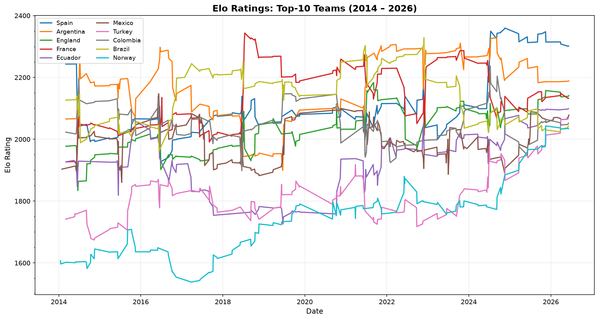
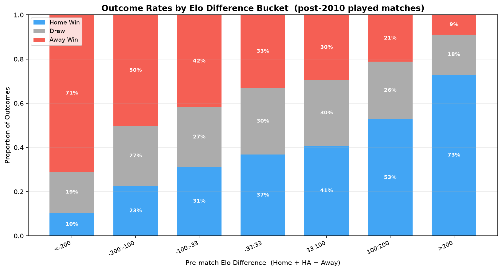

# World Cup 2026 x Polymarket: a forecasting model, and an honest test of whether it beat the market

**Summer 2026.** I built a match and tournament model for the 48-team FIFA World Cup, then a system that compared it with Polymarket prices in real time. The modelling was the easy part. The project's real result is the scoreboard I built to check whether the model's "edges" were real, and its answer: **no edge.** The market was sharper than my model.

```
predictor/   the forecasting model: Elo, features, models, evaluation, tournament simulator (Python package src/)
engine/      the market engine: Streamlit dashboard, EV engine, Polymarket client, portfolio sizing, the verdict scoreboard
figures/     two figures from the predictor's Elo ratings
```

## Part 1: the forecasting model (`predictor/`)

**The constraint that shaped everything:** international football is data-poor, at about 8–12 matches per team per year. So the model is deliberately simple, every validation is walk-forward (never a random split), and a backtest that looks too good is treated as a leak until proven otherwise. A leakage audit runs as a test gate (`predictor/tests/test_leakage_audit.py`): every feature for a match on date D uses only data from before D. Re-run in November 2026 against the final modelling table, it flags two edge cases among the 8,809 matches that have squad values: one match played on 1 January uses the squad-value snapshot dated that same day (the feature code uses ≤, the audit demands strictly before), and one team falls back to an older snapshot than the audit expects. I've left both as found.

**The model:**

```
Elo ratings (margin-of-victory and match-importance weighted; parameters tuned on pre-2010 data, then frozen)
   ├─► XGBoost classifier (10 features, depth 3, heavily regularised: Elo difference, squad market-value ratio, venue, rest days, …)
   └─► Dixon–Coles bivariate Poisson goals model (time-decayed)
         ▼
   50/50 average → temperature scaling (T ≈ 1.04) → win/draw/loss probabilities
         ▼
   Monte Carlo tournament simulator: 100,000 runs of the full 48-team bracket,
   with the official third-place ranking and Round-of-32 slot rules, per-team rating uncertainty,
   lower-scoring knockouts, and penalty shootouts at 50/50
```

**Walk-forward results** on 7,178 matches from 2019 to 2026, never touched during development (ranked probability score, lower is better):

| Model | RPS |
|---|---|
| "Higher Elo wins" | 0.188 |
| Logistic regression on Elo difference | 0.172 |
| Dixon–Coles | 0.182 |
| XGBoost | 0.170 |
| **50/50 ensemble (shipped)** | **0.1694** |

The honest reading: the ensemble beats the plain Elo baseline by about 1.5%, roughly one bootstrap standard error. About 80% of XGBoost's feature importance comes from Elo. It is mostly an Elo model with careful plumbing.

**Decisions I'd defend:**

- **Equal 50/50 weights, not learned ones.** The forecast-combination puzzle: simple averages beat estimated weights out of sample, because the weights carry their own estimation error.
- **More simulations don't help.** At 100,000 runs the sampling error is under 0.1 percentage points, while the model's specification error is 1–5 points.
- **The real lever was squad market value**, the one feature that knows something Elo doesn't. It was missing for 83% of training rows. Adding 39 more national teams (each ID checked automatically, which caught two club teams posing as countries) raised coverage from 16.5% to 29.5% and improved ensemble RPS from 0.16968 to 0.16942, with the biggest gain on cross-confederation matches, where theory says it should be.
- **Calibrating the tail.** The betting side lives in longshot probabilities, which are controlled by the per-team rating-uncertainty setting, not by accuracy. A sweep showed it moves the favourite's title chance by 4.5 points and the longshot field by 12. I kept it at the conservative end of the range implied by how much ratings actually move, because overstating longshots manufactures false edges.

The design notes are in `predictor/docs/`: `QUANT_THEORY_AND_DESIGN.md` (the full reasoning), `PHASE_DECISIONS.md`, `MODEL_REVIEW.md`, and the portfolio and latency-arbitrage notes.

### Figures

| | |
|---|---|
|  |  |
| Elo ratings of the current top 10, 2014–2026 | Home win, draw and away win rates by pre-match Elo gap: the rating separates outcomes cleanly |

## Part 2: the market engine (`engine/`)

The second system pulled live Polymarket prices for tournament futures (winner, reach the final, advance from group) and match moneylines, and compared them with the model:

- **Shrinkage toward the market.** A model probability is blended with the market price (trust 0.35), and the selected edges get a further haircut for the winner's curse: when you scan 60 contracts and pick the five the model disagrees with most, those are disproportionately where the model is wrong.
- **Executable prices.** EV is computed against the ask, not the mid, with the overround shown.
- **Correlation-aware portfolio sizing.** The simulator's full joint matrix (one row per simulated tournament, one column per outcome) gives the exact probability of a bundle of bets, instead of multiplying marginals. "Team X wins the title" and "team X reaches the final" are one bet, not two.
- **Size to survive.** A single tournament has no law of large numbers, so stakes use fractional Kelly with a cap per bet. A Kelly-tilted split nearly doubled the median outcome against an equal split, for about 10% less mean. Weighting can't change the chance of losing everything; only the choice of bets can.

`engine/docs/STRATEGY_REVIEW.md` is the critique I wrote of my own strategy before trusting it, with the fixes that followed.

## Part 3: the scoreboard, and what it said

I separated two questions and wrote down the tests in advance (`engine/utils/verdict.py`):

- **Q1: is the market beatable at all?** Favourite–longshot bias, draw pricing and open-to-close drift, measured on real prices and results. This doesn't use my model.
- **Q2: does my model beat the market?** Measured only forward: a daily snapshot (`engine/snapshot_daily.py`) logged the model's probability and the market price for every market, so there's no look-ahead and no selection bias from only logging bets. The tests are Brier skill against the market, closing-line value (CLV) with a significance test, calibration, and a paper-trading return.

**The verdict at 48 resolved markets (30 Jun 2026): no edge.**

| Test | Result |
|---|---|
| Brier skill vs the market | −0.032 (the market was sharper) |
| Closing-line value | +0.06¢, p = 0.69 (indistinguishable from zero) |
| Paper trading, picks where the model beat the market by ≥ 5 points | 1 of 20 won |
| The apparent draw edge | shrinking as data grew: +7 points (p ≈ 0.30) → +4.3 points (p ≈ 0.44) |

The forward forecast log ends on 10 Jul 2026, but the results feed the scoreboard reads was last updated on 27 Jun, so 48 resolved markets is the final sample. Re-running the scoreboard on the full log gives the same numbers and the same verdict: **NO EDGE**.

**Real money.** I placed 11 small real-money bets during the tournament: 2 match bets and 9 group-stage futures. 3 of the 11 won, and the final return was **−27.5% of total stake** (all bets settled from Polymarket’s resolved markets). The average closing-line value was negative, at about −4¢ per bet, so the prices mostly moved against my entries. Eleven bets prove little either way; the forward scoreboard above is the evidence that counts, and it points the same way.

**What the scoreboard caught along the way:**

- An early version of the verdict counted a CLV of +0.06¢ at p = 0.70 as "promising". A win now has to clear a significance threshold.
- A trust-calibration routine recommended raising trust in the model to 1.0. It was fitting on about one real data point: closed markets had no price, and the code had filled the gap with the model's own probability. A boundary optimum with a tiny Brier gain is an artefact, not a signal.

## What I'd take from this

1. **A model–market gap isn't an edge until it beats the closing line.** The EV column measured how much the model disagreed with the market, and the market was more often right.
2. **Cheap contracts are where false edges live.** The favourite–longshot bias runs against anyone buying longshots (see the companion study, [polymarket-favourite-longshot](https://github.com/braamg/polymarket-favourite-longshot)).
3. **Selecting the biggest disagreements selects the model's biggest errors.**
4. **Pre-register the tests and gate them on significance,** or you'll tell yourself a winner's story the data doesn't support.
5. **Sizing matters more than picking** on a single event: survive first.
6. **In data-poor domains, simple models and frozen hyperparameters are a feature.**

## Running it

```bash
cd predictor
python -m venv venv && source venv/bin/activate      # Windows: venv\Scripts\activate
pip install -r requirements.txt                       # a full pip freeze from the original environment
pytest tests/test_wc2026_bracket.py                   # bracket and third-place allocation rules, no data needed
```

The match data is downloaded on first use from the public [international results dataset](https://github.com/martj42/international_results) (`src/data/ingestion.py`) into `predictor/data/`, which is gitignored. The leakage audit skips until the modelling table has been built. The pipeline scripts that build the tables and run the simulator are not included; the package in `predictor/src/` holds the logic they called.

The dashboard: `cd engine && pip install -r requirements.txt && streamlit run app.py`. It needs the simulator's outputs (`sim_probabilities.json` and friends, see `engine/.env.example`); without them it falls back to clearly-labelled mock data.

## What is not in this repository

- **No data.** No match results, squad values, sportsbook odds, Polymarket price history, simulator outputs, forecast log or bet ledger. The code downloads or rebuilds what it needs.
- **No order placement, and no scraper.** The two modules that could place real Polymarket orders, and the Transfermarkt squad-value scraper (Transfermarkt's terms forbid scraping), are left out; `predictor/src/features/market_value.py` keeps the leak-free feature logic and works on any squad-value table you supply.
- **No credentials.** API keys are read from the environment only (`ODDS_API_KEY` for the optional sharp-odds feed); see the `.env.example` files.

## Data and licences

Code: MIT (see `LICENSE`). The international match results come from [martj42/international_results](https://github.com/martj42/international_results), released under CC0; the two figures are derived from it. Squad market values, sportsbook odds and Polymarket prices each have their own terms, so none of that data is included.
